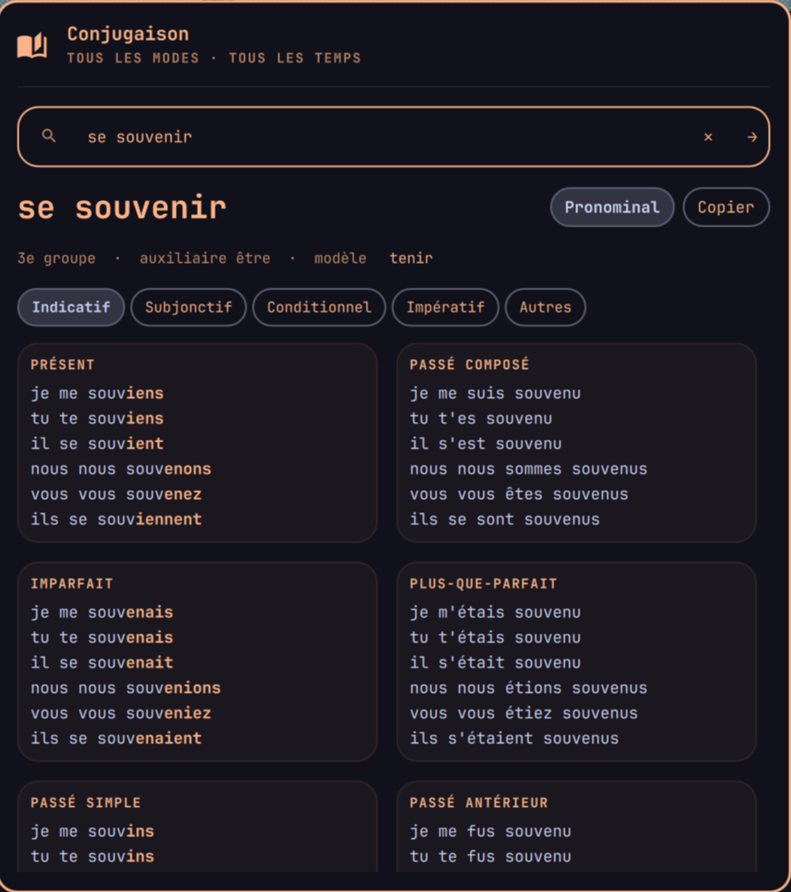

# Conjugaison FR

Widget de barre Omarchy pour conjuguer les verbes français, à la manière
d'un Bescherelle : tous les modes, tous les temps, avec les terminaisons
mises en évidence. Uniquement en français, et entièrement hors ligne.



Inspiré du plugin [Dictionary & Thesaurus](https://github.com/LDockwiller/omarchy-dictionary-thesaurus-1)
(même widget de barre et même popup), mais consacré à la conjugaison.

## Fonctionnalités

- **7 000 verbes** (données [Verbiste](https://perso.b2b2c.ca/~sarrazip/dev/verbiste.html)),
  sans connexion ni clé d'API.
- **Tous les temps** : indicatif (présent, passé composé, imparfait,
  plus-que-parfait, passé simple, passé antérieur, futur simple, futur
  antérieur), subjonctif (présent, passé, imparfait, plus-que-parfait),
  conditionnel (présent, passé), impératif (présent, passé), infinitif,
  participe et gérondif.
- Présentation en deux colonnes : chaque temps simple à côté de son temps
  composé, terminaisons en couleur.
- Groupe, auxiliaire (avec les verbes qui changent d'auxiliaire : *monter*,
  *sortir*, *passer*…) et **verbe modèle**, cliquable.
- **Forme pronominale** : tapez « se laver », « s'asseoir », ou cliquez sur
  *Pronominal*.
- **Formes conjuguées** : tapez « fîmes » ou « vais » et le plugin retrouve
  l'infinitif ; « suis » propose *être* ou *suivre*.
- **Fautes de frappe** : « mangre » propose *manger*, « etre » trouve *être*.
- Variantes orthographiques (je paie / paye, je m'assieds / assois).
- Bouton *Copier* pour copier toute la conjugaison.

## Installation

```bash
omarchy plugin add https://github.com/LDockwiller/becherel-fr.git --enable
```

Une icône de livre apparaît dans la barre. Cliquez dessus, tapez un verbe et
appuyez sur Entrée. Échap efface la recherche puis ferme le popup.

Il peut aussi être piloté en IPC :

```bash
qs ipc -p /usr/share/omarchy/shell call becherel-fr conjugate "prendre"
qs ipc -p /usr/share/omarchy/shell call becherel-fr toggle
```

Et le moteur s'utilise seul, en ligne de commande (sortie JSON) :

```bash
~/.config/omarchy/plugins/io.github.ldockwiller.becherel-fr/conjugue.py "s'asseoir"
```

## Désinstallation

```bash
omarchy plugin remove io.github.ldockwiller.becherel-fr
```

## Fonctionnement

- `conjugue.py` charge `data/verbes.json` (les modèles de conjugaison de
  Verbiste), applique le modèle du verbe pour les temps simples, puis
  construit les temps composés (auxiliaire + participe passé, accordé avec
  *être*), les élisions (*j'*, *m'*, *qu'il*, h aspiré) et la forme
  pronominale.
- `Panel.qml` affiche le résultat ; `BarWidget.qml` est l'icône de la barre.
- `tools/build-data.py` régénère `data/verbes.json` à partir des fichiers XML
  de Verbiste (`verbs-fr.xml`, `conjugations-fr.xml`).

## Prérequis

- Omarchy avec `omarchy-shell`
- Python 3 (déjà présent sur Omarchy), `wl-copy` pour le bouton *Copier*

## Licence

GPL-3.0-or-later, car les données de conjugaison viennent de Verbiste
(GPL-2.0-or-later). Voir [NOTICE.md](NOTICE.md).
